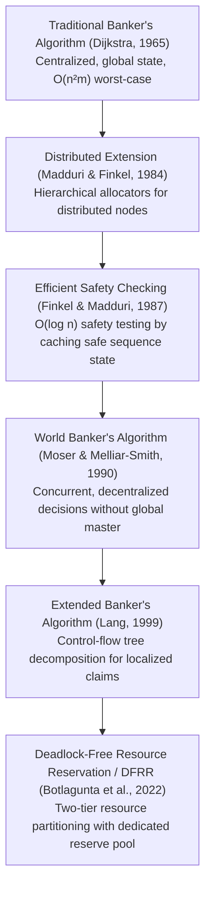

# Research Study & Comparative Analysis: Traditional Banker's Algorithm vs. DFRR

**Project**: Resource Allocation Simulator: Deadlock Avoidance Using Banker's Algorithm with Research-Based Resource Reservation  
**Course**: Operating Systems | Second Year Computer Engineering (SYCM3, Semester III, AY 2026–2027)  
**Institution**: Shah & Anchor Kutchhi Engineering College, Chembur, Mumbai  
**Authors**: Yash Khapre (PRN 125BTCM1149, Roll 25) & Aman Kumar (PRN 125BTCM1092, Roll 26)  
**Faculty Guide**: Mrs. Vaishali Kosambkar  

---

## 1. Synthesis of Studied Research Literature

To bridge classic operating systems textbook theory and modern peer-reviewed computer science literature, this project synthesizes five seminal papers tracing the evolution of deadlock avoidance:

### Summary of Literature Review:
1. **Madduri & Finkel (1984)** — *Information Processing Letters*, 19(1): Addressed communication bottlenecks in multi-computer systems by structuring allocators hierarchically.
2. **Finkel & Madduri (1987)** — *Information Processing Letters*, 24(1): Optimized safety checking by preserving previously validated sequences in an active graph, reducing redundant permutations to $O(\log n)$.
3. **Moser & Melliar-Smith (1990)** — *Journal of Parallel and Distributed Computing*, 9(4): Allowed processes to independently negotiate resources across distributed networks.
4. **Lang (1999)** — *IEEE Transactions on Software Engineering*, 25(3): Eliminated the strict assumption that processes must declare global maximum claims up front by analyzing branch paths in execution trees.
5. **Botlagunta, Agrawal & Rao (2022)** — *International Journal of Information Technology*, 14(2): Introduced the **Deadlock-Free Resource Reservation (DFRR)** technique for dynamic multi-tenant systems.

---

## 2. In-Depth Study: Deadlock-Free Resource Reservation (DFRR)

### 2.1. Principle of Operation
In traditional Banker's Algorithm, all unallocated resource instances reside in a single homogeneous pool ($\text{Available}$). If the available pool falls below the remaining need of every unfinished process, the system stalls or refuses requests because safety cannot be guaranteed.

The **DFRR approach (Botlagunta et al., 2022)** introduces a structured resource partition:
1. **Normal Available Pool ($\text{Available}_{\text{norm}}$)**: Freely allocatable to incoming process requests.
2. **Reserved Resource Pool ($\text{Reserved}$)**: A guarded emergency pool dedicated to unblocking processes that have reached a deadlock bottleneck.
3. **Allocated Pool ($\text{Allocation}$)**: Instances currently held by active processes.

### 2.2. Accounting Invariants
At all times $t$, total system physical instances satisfy:
$$\text{Total}[j] = \sum_{i=0}^{n-1} \text{Allocation}[i][j] + \text{Available}_{\text{norm}}[j] + \text{Reserved}[j]$$

### 2.3. The Unblocking Mechanism
When no active process satisfies $\text{Need}[i] \le \text{Available}_{\text{norm}}$:
1. The allocator searches for a candidate process $P_k$ whose deficit can be bridged by the reserve pool:
   $$\forall j \in [0, m-1]: \text{Need}[k][j] \le \text{Available}_{\text{norm}}[j] + \text{Reserved}[j]$$
2. If found, DFRR loans the deficit $\text{Deficit}[j] = \max(0, \text{Need}[k][j] - \text{Available}_{\text{norm}}[j])$ from the reserved pool.
3. Process $P_k$ executes to completion.
4. Upon termination:
   - The loaned deficit is immediately restored to the **Reserved Pool**.
   - The held resources previously in $\text{Allocation}[k]$ are added to the **Normal Available Pool**.
5. The general pool expands, unlocking subsequent processes.

---

## 3. Side-by-Side Comparison

| Dimension | Traditional Banker's Algorithm | DFRR Research Prototype |
| :--- | :--- | :--- |
| **Deadlock Avoidance Mechanism** | Cautious search for a complete topological safe sequence across all processes. | Dynamic two-tier buffering with targeted unblocking of deficit processes. |
| **Resource State Partitioning** | Single unpartitioned free pool ($\text{Available}$). | Dual-tier partitioning: Normal Available + Reserved Pool. |
| **Worst-Case Search Complexity** | $O(n^2 \cdot m)$ permutation evaluations on each request. | $O(m)$ direct reservation management; $O(n)$ pool sizing. |
| **Behavior on Small Free Pools** | Stalls or rejects requests immediately if no full sequence exists. | Unblocks candidate processes by loaning from the reserve pool. |
| **Resource Availability for Normal Requests** | 100% of unallocated instances are available to any process. | Reserve pool is locked, reducing immediate capacity for general tasks. |
| **Assumptions** | Exact maximum claim of all processes known before execution begins. | Reserve pool must be sized sufficiently to bridge the largest single deficit. |

---

## 4. Academic Caveats, Assumptions, and Fair Comparison

### 4.1. Prototype Disclosure
Our simulator's DFRR implementation is an **educational research-inspired prototype**. We model the fundamental two-tier reservation and unblocking concept outlined by Botlagunta et al. (2022). It should not be presented as a production kernel scheduler or a proven formal replacement for Dijkstra's safety theorem.

### 4.2. Why Direct Comparisons Must Be Qualified
1. **Trade-off in General Throughput**: While DFRR allows systems with tight available resources to avoid stalls (as demonstrated in Example F), reserving a slice of total resources inherently restricts the resources immediately available for everyday tasks.
2. **Dependence on Reserve Pool Sizing**: If the configured reserved pool is smaller than the deficit of the smallest pending process, DFRR stalls just like Banker's.
3. **Process Completion Guarantee**: Both models rely on the fundamental assumption that once a process receives its full required allocation, it terminates in finite time and releases all resources without failing or crashing.

---

## 5. Experimental Results from Simulator

Executing both engines on the benchmark scenarios built into the simulator demonstrates:
- **In Example A (SLA-1 Standard Sample)**: Both algorithms complete successfully. Banker's achieves completion in $\sim 45 \mu s$ with 3 eligibility checks; DFRR completes without needing any reserve pool interventions.
- **In Example F (Bottleneck Scenario)**:
  - Allocation: `[[2,1],[1,2],[1,1]]`, Maximum: `[[4,2],[2,4],[3,2]]`, Normal Available: `[0,1]`.
  - Traditional Banker's on Normal Available is **UNSAFE** (immediate stall, 0 processes can start).
  - DFRR with Reserved Pool `[2,0]` invokes 1 reservation, unblocks $P_0$, and successfully completes all processes ($P_0 \to P_1 \to P_2$).
